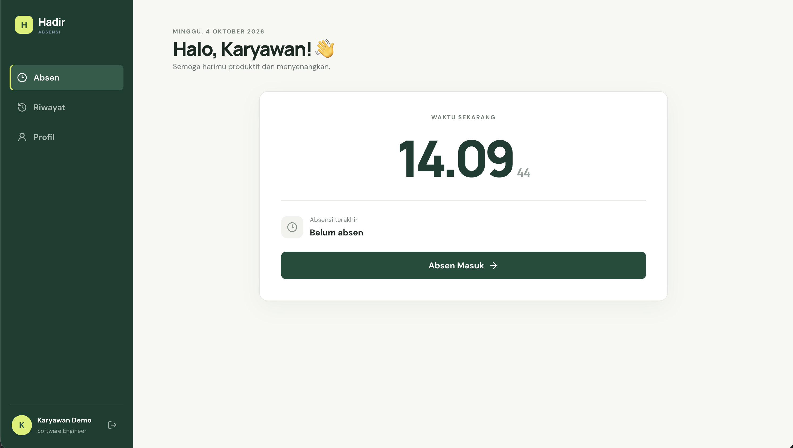
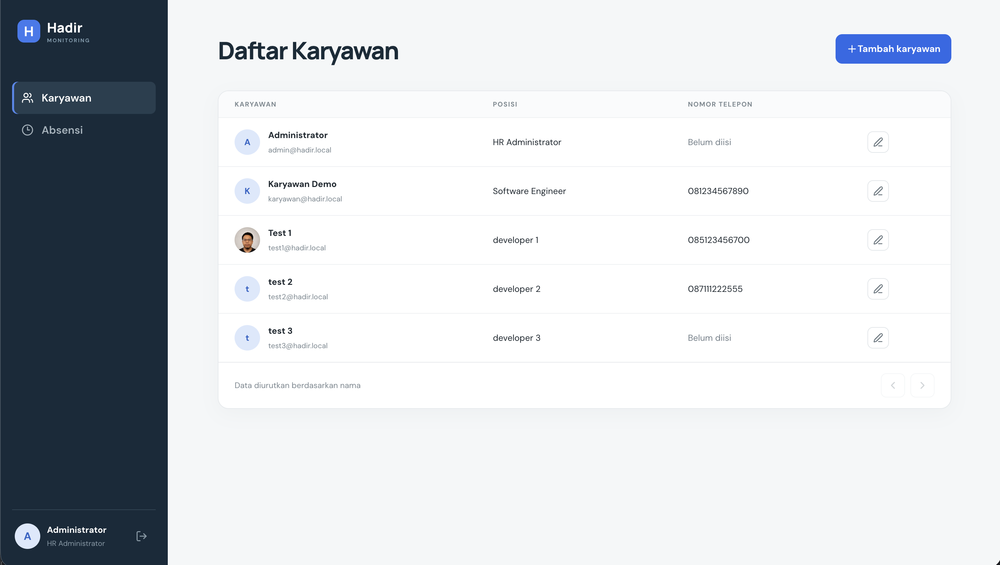
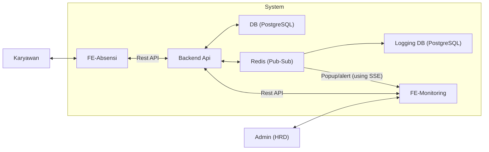
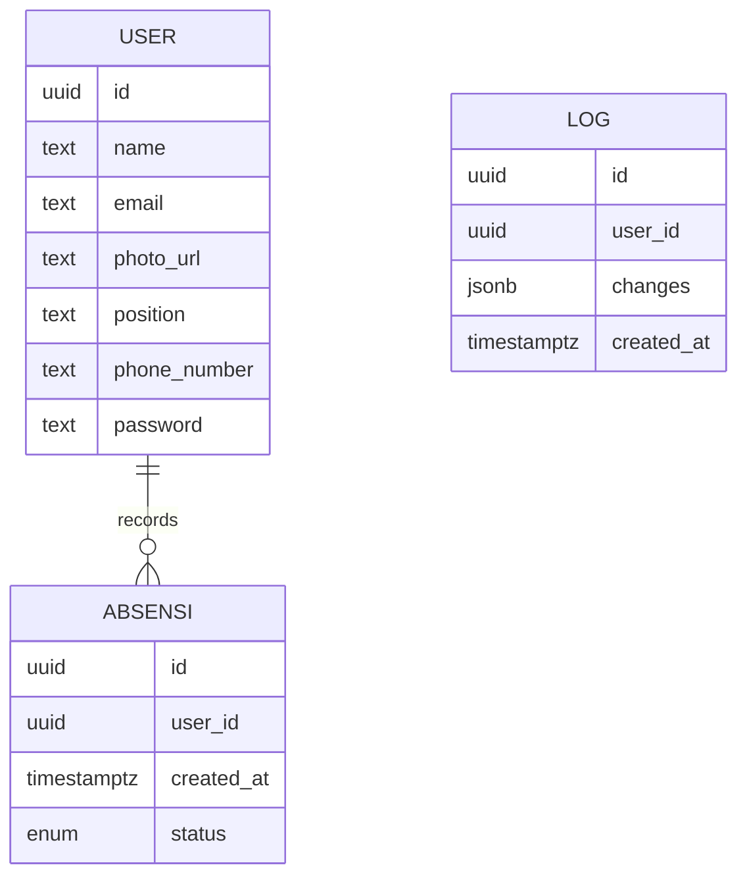

## Struktur project

Di repository ini terdapat 3 aplikasi: backend, frontend absensi (untuk karyawan), dan frontend monitoring (Admin HRD). Dengan struktur folder sebagai berikut:

```text
.
├── backend/
│   ├── migrations/
│   ├── src/
│   └── test/
├── fe-absensi/
│   └── src/
├── fe-monitoring/
│   └── src/
└── README.md
```

## Architecture Diagram



Tech stack: Typescript, React.js, Tailwind CSS, Tanstack Router, Tanstack Query, NestJS, PostgreSQL, SSE (untuk popup/alert di halaman admin), dan Redis (untuk Pub-Sub).

Notes:

- Untuk popup/alert sebenarnya bisa memakai firebase atau websocket. Akan tetapi saya rasa SSE lebih simple dan lebih cocok dan cukup menjawab kebutuhan

- Begitu juga untuk keperluan Pub-Sub, menurut saya Kafka, RabitMQ, AWS SQS, GCP Pub-
  Sub terlalu overkill, dan membutuhkan setup yang cukup kompleks, sehingga untuk kebutuhan yang simple seperti logging dan alert saya memilih fitur Pub-Sub dari Redis. Akan tetapi di sini saya menggunakan adapter pattern sehingga mudah untuk diswap ke teknologi tersebut jika memang diperlukan

- Berdasarkan requirement, ketika ada perubahan data karyawan, data harus masuk ke message queue untuk kemudian dimasukkan ke database terpisah untuk kebutuhan logging. Untuk simplifikasi, saya tidak akan menggunakan database terpisah, melainkan hanya akan membuat table tersendiri di dalam database postgresql yang sudah ada.

## Database Design



## Menjalankan project

Prasyarat:

- Node.js 20 atau lebih baru
- npm
- Docker dengan Docker Compose (untuk local postgresql dan redis)

### 1. Backend dan service lokal

```bash
cd backend
cp .env.example .env
npm install
npm run services:up     # menjalankan docker container postgresql dan redis
npm run migrate:up      # membuat sql table dan akun demo
npm run start:dev
```

Backend tersedia di `http://localhost:3000`.

Akun demo:

| Peran    | Email                  | Password       |
| -------- | ---------------------- | -------------- |
| Admin    | `admin@hadir.local`    | `Admin123!`    |
| Karyawan | `karyawan@hadir.local` | `Karyawan123!` |

### 2. Frontend absensi

```bash
cd fe-absensi
npm install
npm run dev
```

Frontend absensi tersedia di `http://localhost:5173`.

### 3. Frontend monitoring

```bash
cd fe-monitoring
npm install
npm run dev
```

Frontend monitoring tersedia di `http://localhost:5174`.
